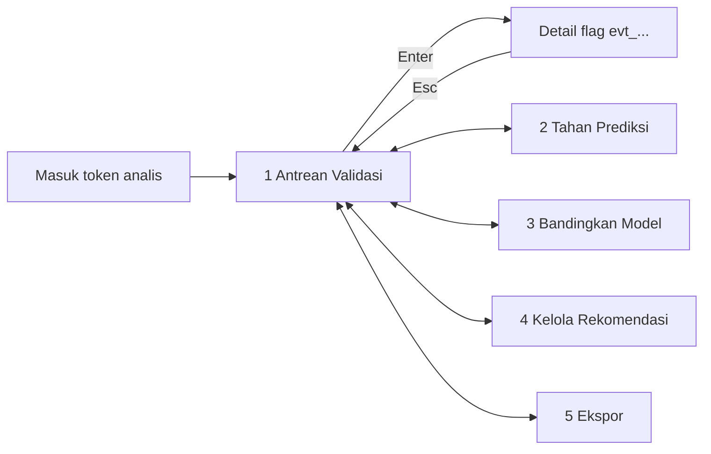

# Flow dan screen desktop analis Windows (TTN-DSG-004)

Rujukan: `produk/22-kontrak-desktop-windows.md` §2-§4, `PRD/30-kriteria.md` US-004, `FSD/10-alur.md` ("Urutan Layar Web dan Desktop"). Token: `tokens/` v0.2.0 (identik dengan web). Prototipe statis (HTML + CSS token, tanpa JS, data contoh ilustrasi): `src/prototipe/desktop/*.html`; bangun dengan `npm run build:tokens && node scripts/bangun-prototipe.mjs desktop`. Figma: belum ada (lihat README). Hanya analis internal; bukan petani/vendor.

## Kerangka jendela (min 1120 x 720)

Bar atas (nama aplikasi, status Daring/Luring, waktu segarkan, tombol Segarkan), navigasi kiri 208 px (5 layar), area kerja, bilah pintasan bawah. Tabel padat: sel 14 px, baris rapat, **zebra** (`--ttn-zebra`), kepala tabel menempel. Status = lencana warna + bentuk + teks (`tokens/sinyal.spec.json`). Target ketuk desktop 36 px.

## Flow

## Lima layar

| # | Layar | Berkas | Isi | Aturan yang digambar |
|---|---|---|---|---|
| 1 | Antrean Validasi | `antrean-validasi.html` | Tabel flag `perlu_verifikasi` (event_id, jenis, komoditas·pasar, nilai, status) + panel keputusan `setuju / koreksi_nilai / tolak` | Alasan 10–140 karakter; **Kirim nonaktif sampai valid**: varian 0, 9, 10, 38 (valid), 141 karakter dengan penghitung `n/140` |
| 2 | Tahan Prediksi | `tahan-prediksi.html` | Form komoditas + pasar + alasan + berlaku sampai; tabel penahanan aktif/kedaluwarsa | Maks 7 hari lalu "Kedaluwarsa otomatis"; varian tanggal > 7 hari menonaktifkan tombol |
| 3 | Bandingkan Model | `bandingkan-model.html` | Tabel MAPE H+7 versi berjalan vs kandidat (12 komoditas, backtest 90 hari) + checklist syarat | **Naikkan versi** aktif hanya bila MAPE H+7 turun ≥ 0,5 poin dan tidak ada komoditas memburuk > 2 poin; varian nonaktif dengan penjelasan |
| 4 | Kelola Rekomendasi | `kelola-rekomendasi.html` | Tabel 5 rekomendasi + form status, penanggung jawab (nama), tanggal target konkret | Simpan nonaktif bila nama/tanggal kosong untuk status Dikerjakan |
| 5 | Ekspor | `ekspor.html` | Jenis (harga H+7, demand, panen, jejak akurasi), format CSV/XLSX, nama berkas, riwayat dengan hash | Nama `titeny_<jenis>_YYYYMMDD_HHmm.xlsx`, maks 50.000 baris per berkas (dipecah), jejak ekspor SHA-256 |

## Pintasan keyboard

| Pintasan | Aksi | Catatan |
|---|---|---|
| `Ctrl+R` | Segarkan | selalu tersedia; tombol Segarkan di bar atas |
| `Ctrl+E` | Ekspor | membuka layar Ekspor; di layar Ekspor memulai ekspor |
| `Esc` | Kembali | detail flag -> daftar; tutup dialog; sesuai back stack maks 20 |
| `Enter` | Buka detail flag baris terpilih | deep link `titeny://analis/flag/<eventId>` |

Bilah pintasan tampil di dasar setiap layar. Fokus keyboard memakai cincin 3 px `--ttn-fokus`.

## Mode luring

Banner (bar atas + varian di tiap layar): **"Luring — data 2026-10-03 23.00"**; membaca cache SQLite terakhir. Aksi tulis (setuju/koreksi/tolak/tahan/ubah rekomendasi) diantre dengan lencana "Antre kirim" dan terkirim saat daring memakai kunci idempoten `aksi_id`. Naikkan versi dan ekspor-ulang dari server tidak tersedia luring.

## Keadaan lain

Antrean kosong ("Antrean kosong", lencana hijau), validasi gagal per field (tepi merah + pesan), ekspor selesai/dipecah. Tabel alternatif grafik: layar desktop tidak memuat grafik; semua data berupa tabel.

## Verifikasi

`npm test`: membangun prototipe lalu memuat tiap layar di Chrome headless dalam iframe 1120 x 720 dan memastikan `scrollWidth <= 1120`; menegaskan jumlah tombol Kirim aktif/nonaktif per panjang alasan, tombol Naikkan versi aktif/nonaktif, teks banner luring, pintasan, zebra, lencana berisi bentuk + teks. Tidak diuji pada Windows sungguhan atau dengan pembaca layar (Narrator).

## Temuan dokumen

1. `FSD/10-alur.md` menyebut tujuan navigasi: Masuk, AntreanValidasi, **DetailFlag**, TahanPrediksi, BandingModel, KelolaRekomendasi, Ekspor (7), sedangkan `22-kontrak-desktop-windows.md` mengunci **5 layar**. Desain mengikuti 5 layar; DetailFlag digambar sebagai panel dalam Antrean Validasi, Masuk tidak digambar (di luar tiket).
2. Syarat Naikkan versi di kontrak merujuk "§model" yang tidak ada; syarat diambil dari PRD US-004. Frasa "rerata semua komoditas" untuk penurunan 0,5 poin adalah asumsi desain.
3. Format tampilan tanggal target (YYYY-MM-DD) dan batas tanggal penahanan (hari ini + 7) adalah asumsi desain.
