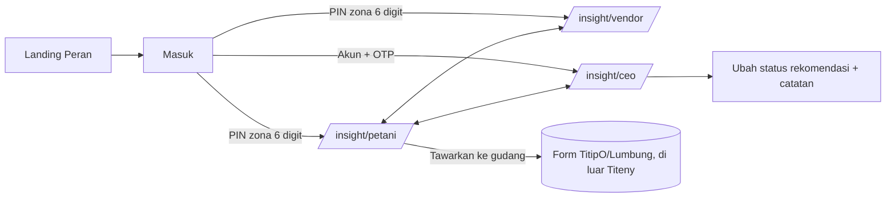

# Flow dan screen papan web 360 px (TTN-DSG-003)

Rujukan: `produk/10-papan-insight.md` §2-§4, `PRD/30-kriteria.md` US-001..US-003, `FSD/10-alur.md` (urutan layar web). Token: `tokens/` (v0.2.0). Prototipe statis (HTML + CSS token, tanpa JS, data contoh ilustrasi): `src/prototipe/web/*.html`; bangun dengan `npm run build:tokens && node scripts/bangun-prototipe.mjs web`, lalu buka berkas di browser. Sumber desain: pencil.app (lihat README).

## Flow

Pemilih peran (tiga tombol, tinggi 44 px) ada di atas setiap papan; peran di luar hak akses mengarah ke Masuk.

## Screen

| Screen | Berkas | Isi (urutan vertikal, satu kolom) |
|---|---|---|
| Landing Peran | `landing.html` | 3 kartu peran + jenis akses |
| Masuk | `masuk.html` | PIN zona 6 digit (petani/vendor); akun + OTP (CEO); keadaan PIN salah |
| Papan petani | `petani.html` | Filter komoditas/kabupaten, stempel waktu, 4 kartu: harga (angka besar + grafik P50 dengan pita P10-P90), keputusan (lencana JUAL SEKARANG / TAHAN 3 HARI / CICIL JUAL + 1 kalimat alasan), cuaca-panen (hujan 7 hari, panen M+1..M+4), tindak lanjut ("Tawarkan ke gudang") |
| Papan vendor | `vendor.html` | Zona, peringatan zona (seimbang/waspada/defisit), tabel besok `komoditas \| harga besok \| demand H+7 (kg) \| saran stok (kg)`, input stok di tangan (lokal) |
| Papan CEO | `ceo.html` | Tab Ringkasan / Akurasi. Ringkasan: matriks 5x12, kurva S10 30 hari + 2 anotasi, 5 rekomendasi + "Ubah status". Akurasi: tabel MAPE H+7 per komoditas 4 minggu |

Aturan 360 px: satu kolom, padding 16 px, target ketuk >= 44 px, tabel `table-layout: fixed` (tanpa overflow), tanpa lebar tetap > 328 px. Matriks 5x12 ditampilkan transposisi (baris = komoditas, kolom = 5 kabupaten) supaya muat; isi sel = bentuk + selisih suplai-demand (%) dengan `aria-label` lengkap. Status berwarna selalu disertai teks dan bentuk (`tokens/sinyal.spec.json`).

## Keadaan kosong/error (semua tergambar sebagai "Varian keadaan" di tiap papan)

| Keadaan | Teks tepat | Papan | Perilaku |
|---|---|---|---|
| S1 kosong >= 3 hari | "Data harga belum cukup" | petani, vendor, CEO (sel) | Kartu prediksi/keputusan diganti pesan; kartu lain tetap |
| S3 telat | "Estimasi — transaksi kemarin belum masuk" | vendor | Banner di atas tabel; angka terdampak bertanda "~" |
| Kepercayaan rendah | lencana "Akurasi terbatas" (kuning ▲) | petani | Grafik dan tabel tetap tampil |
| Memuat | "Memuat… Maksimal 12 detik" | semua | Bilah progres + skeleton; tidak ada spinner tanpa batas |
| Timeout 12 detik | "Data belum termuat setelah 12 detik. Menampilkan data tersimpan terakhir: <stempel>" + "Coba lagi" | semua | Tampilkan cache terakhir + stempel waktu |

## Spesifikasi tabel teks alternatif grafik

Setiap `<svg role="img">` memakai `aria-describedby` ke tabel di halaman yang sama (dibungkus `
` "Tabel data grafik (teks alternatif)"; tetap dapat dibaca pembaca layar). Kontrak:

| Grafik | id tabel | Kolom | Baris |
|---|---|---|---|
| Harga petani (garis P50 + pita) | `tabel-harga` | Hari, P50, P10, P90 (Rp/kg) | Hari ini, H+1..H+7 |
| Matriks CEO | `tabel-matriks` | Komoditas, Kab. A..E (selisih % + status 3 huruf) | 12 komoditas |
| Kurva S10 (omzet + margin) | `tabel-s10` | Hari, Omzet (juta Rp), Margin (%) | 30 hari |
| Jejak akurasi | `tabel-akurasi` | Komoditas, M-3..Ini (MAPE H+7 %) | 12 komoditas |

Seri grafik dibedakan gaya garis (solid vs putus-putus) dan label langsung, bukan warna saja; pita P10-P90 bersifat dekoratif karena nilainya ada di tabel.

## Verifikasi

`npm test` membangun prototipe, membuka tiap halaman di Chrome headless dalam iframe 360 px (Chrome headless memaksa jendela >= 500 px, jadi iframe dipakai) dan memastikan `scrollWidth <= 360`, 60 sel matriks, 5 rekomendasi, setiap SVG punya tabel, setiap lencana berisi bentuk + teks. Bukti visual 360 px diperiksa lewat tangkapan layar Chrome saat pengembangan (tidak dikomit).

## Temuan dokumen

1. `10-papan-insight.md` §2 hanya mendefinisikan hijau seimbang / kuning waspada / merah defisit untuk vendor; **surplus tidak punya padanan warna**. Prototipe memetakan surplus ke "Waspada" (kuning) dengan teks "surplus". Perlu keputusan produk.
2. Ambang status matriks tidak ada di dokumen; desain tidak menetapkannya (backend mengirim status).
3. Daftar 12 komoditas dan 5 kabupaten tidak ada di dokumen yang dibaca; prototipe memakai nama contoh.
4. Tidak ada spesifikasi isi "tab Akurasi" selain "jejak MAPE H+7 per komoditas 4 minggu"; target 12% diambil dari `AGENTS.md` repo (MAPE H+7 <= 12%).
